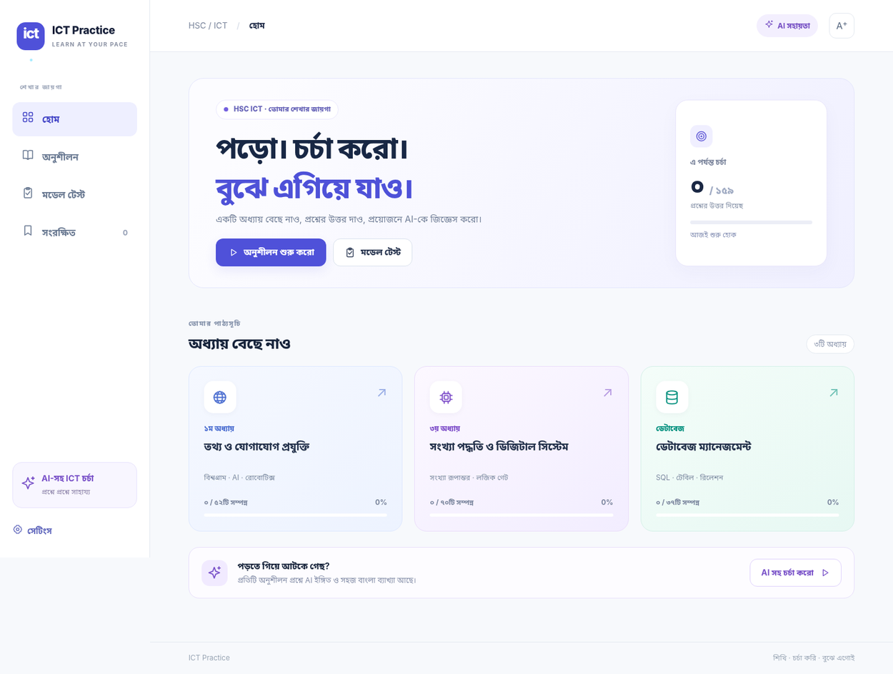
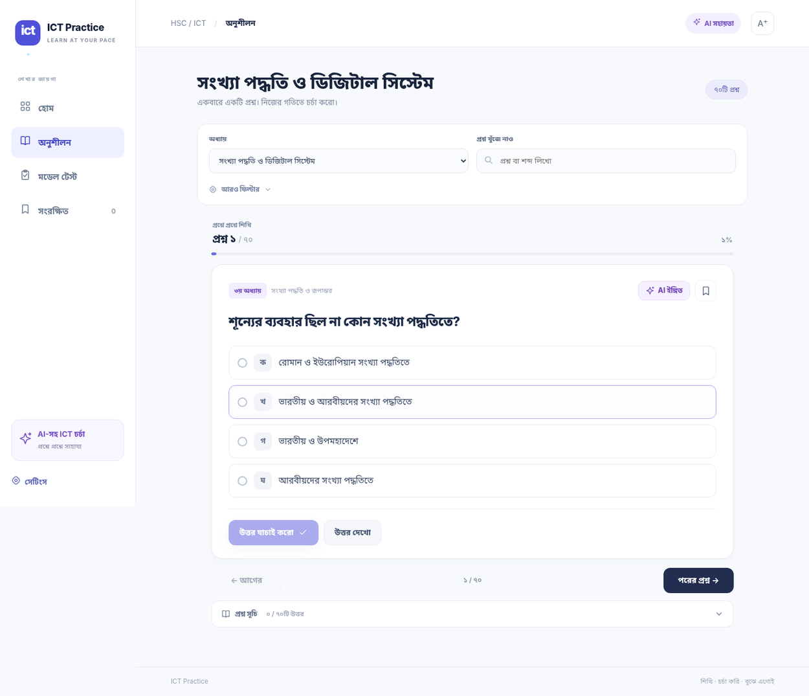
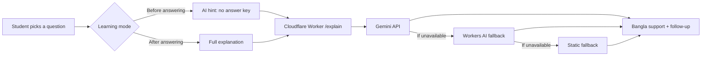
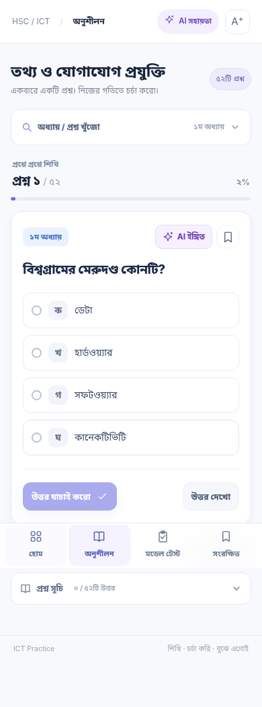

# ICT Practice · Learn with AI

**A focused Bangla ICT learning platform:** one MCQ at a time, instant feedback, AI hints and simple explanations.

[**🌐 Open website**](https://arafat-rahman-lisan.github.io/ict-mcq-practice/) · Static GitHub Pages frontend + Cloudflare Worker AI endpoint



## ✨ Learn → Try → Understand

| 🗂️ Practice | ✨ AI help | 🎯 Model test |
|:--|:--|:--|
| Color-coded chapter cards and one question per screen | **Hint before answering**, explanation after answering and follow-up questions | 20 / 50 / 100 mixed MCQs; answers hidden until submission |



## 🔌 AI integration



**Frontend request:** only the selected MCQ context is sent, never the entire question bank.

```js
const response = await fetch(window.EXPLAIN_API_URL, {
  method: 'POST',
  headers: { 'Content-Type': 'application/json' },
  body: JSON.stringify({ prompt, questionId })
});
const { explanation } = await response.json();
```

`config.js` stores the **public Worker URL**, not the Gemini API key. Keep API keys in **Cloudflare Worker Secrets**. AI responses are advisory and may contain mistakes. The hint prompt requests that the model not reveal the correct choice; it cannot guarantee that the model will comply.

## 📱 Mobile friendly



- One question at a time; optional question index and filters.
- Clearly differentiated blue, purple and green chapters.
- Visible **AI ইঙ্গিত** action before answering; **AI ব্যাখ্যা** after.
- Local bookmarks, progress, exam resume and clear answer states.

## 🛠️ Run / update

**Local:** double-click `START.bat` (Python 3), or run `python serve.py`. Do not open `index.html` directly; the JSON needs a local server.

**GitHub Pages:** upload/update the files **inside this project folder** at your existing repository root (`index.html`, `script.js`, `styles.css`, `config.js`, `data/`, `assets/`). The Cloudflare Worker is deployed separately.

**Data integrity:** the uploaded 277 question records and answer keys are unchanged by this redesign. As before, 118 source-review questions are not scored and are excluded from exams. See `VERIFICATION.md` and `data/text-corrections-audit.json`.
