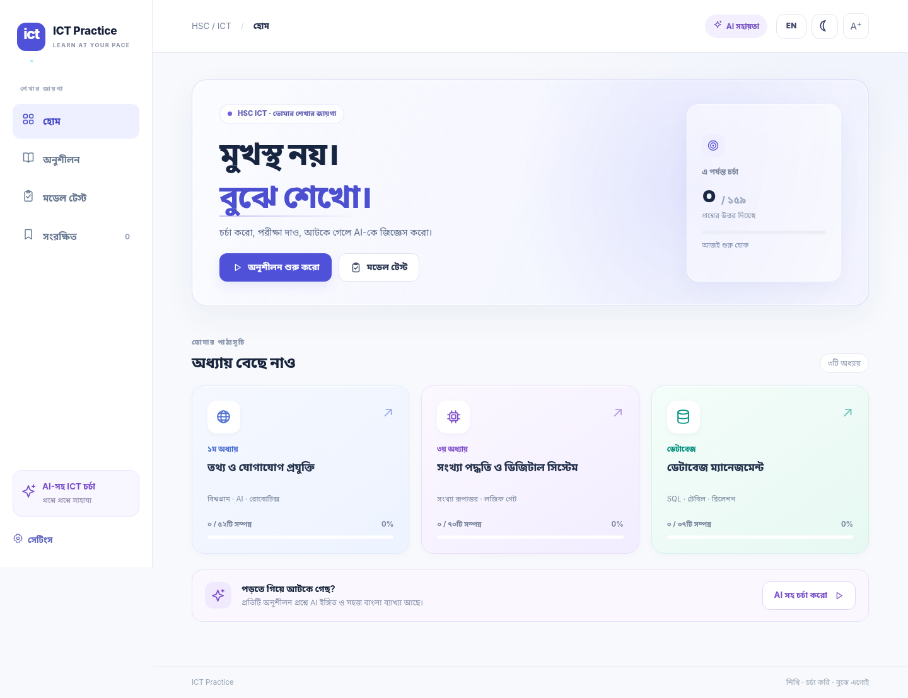
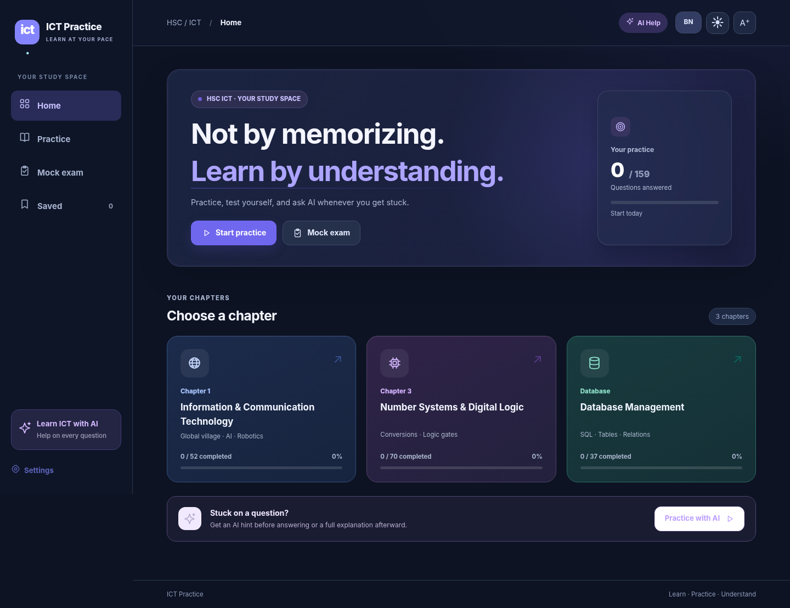
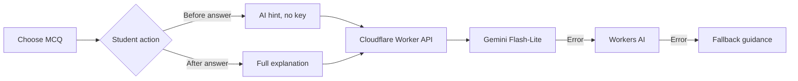
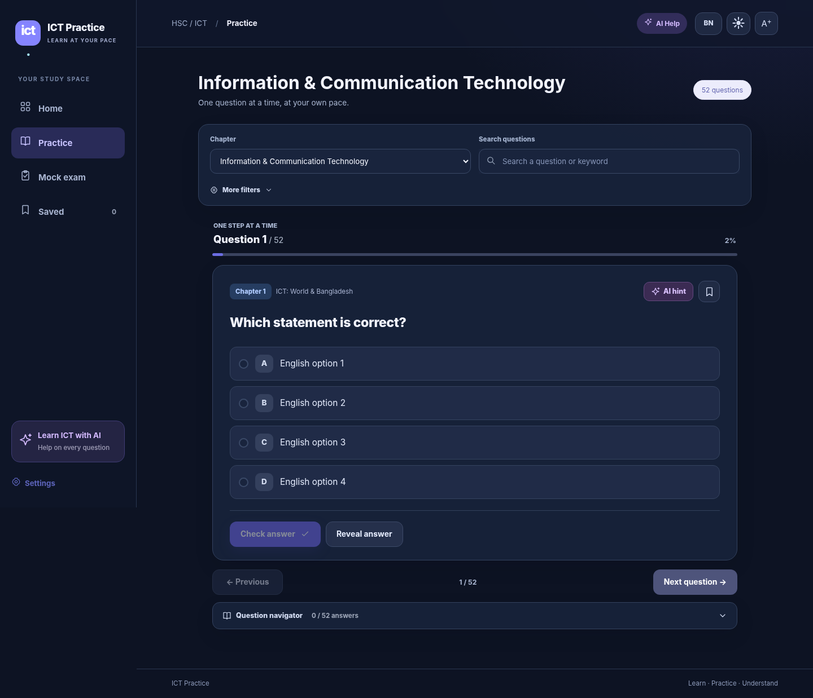

# ICT Practice · Learn with AI

**Understand, don't memorize.** A focused HSC ICT learning site with bilingual controls, question-by-question practice, AI hints and mock exams.

[**Open live website**](https://arafat-rahman-lisan.github.io/ict-mcq-practice/) · GitHub Pages + Cloudflare Worker



## What you can do

| 📚 Learn | ✨ AI guidance | 🎯 Test yourself |
|:--|:--|:--|
| One MCQ at a time, chapter colors, progress and bookmarks | Hint **before** answering; full explanation and follow-ups **after** | 20 / 50 / 100 random MCQs; answers hidden until submission |

| 🌐 Language | 🌗 Appearance | 🫧 Motion |
|:--|:--|:--|
| Bangla / English switch | Saved light / dark theme | Lightweight Three.js hero, decoder text and reduced-motion fallback |



## AI integration



```js
// Only the selected MCQ context; never the whole question bank.
const response = await fetch(window.EXPLAIN_API_URL, {
  method: 'POST',
  headers: { 'Content-Type': 'application/json' },
  body: JSON.stringify({ prompt, questionId })
});
const { explanation } = await response.json();
```

**English questions:** The original bank is Bengali. When EN is selected, a question is translated on demand using the same Worker endpoint, then cached in that browser. **This requires internet/AI availability on first view and uses AI tokens.** If it fails, the original Bengali question is shown with a retry control. English AI explanations use a separate cache. The translation request does **not** contain the answer key; original answer keys and scoring remain unchanged.

**Security:** `config.js` contains only the public Worker URL. Gemini API credentials remain in Cloudflare Secrets. AI hints request no answer, but generated content is not guaranteed to be correct. Exams hide explanations until submission.



## Run and deploy

**Locally:** run `START.bat` or `python serve.py` (Python 3). Opening the HTML file directly does not load the JSON question bank reliably.

**To update existing GitHub:** copy the **contents** of the project into your Git-connected repository root, keeping `.git/` intact. Then:

```bash
git add -A
git commit -m "Add bilingual themes and Three.js learning design"
git push origin main
```

For the full Windows path, see [`DEPLOY.md`](DEPLOY.md). Three.js is imported from a version-pinned CDN as an optional decorative enhancement; if unavailable, the core site still works without it. See [Three.js official documentation](https://threejs.org/manual/pages/fundamentals.html).

**Data integrity:** 277 source records, correct-answer letters and scoring logic are preserved. Questions marked for source review remain excluded from scored tests. See [`VERIFICATION.md`](VERIFICATION.md).
